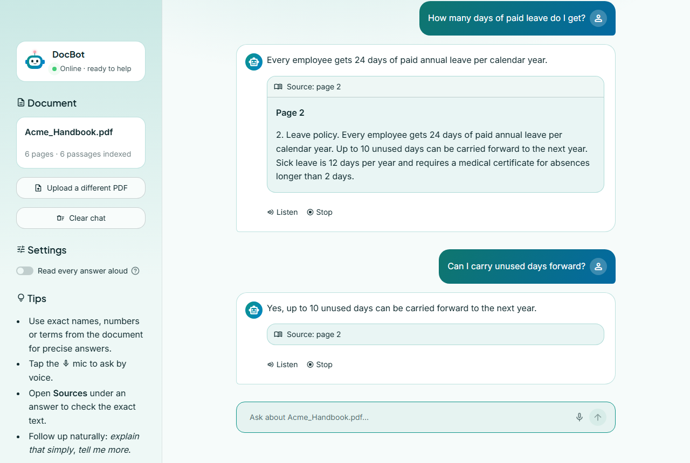
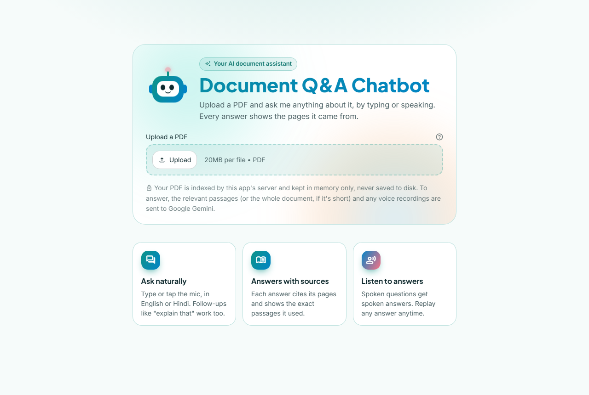
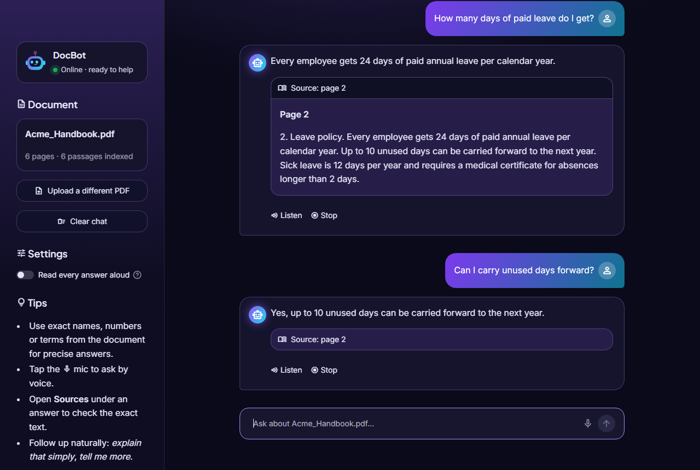
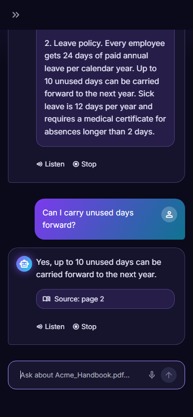
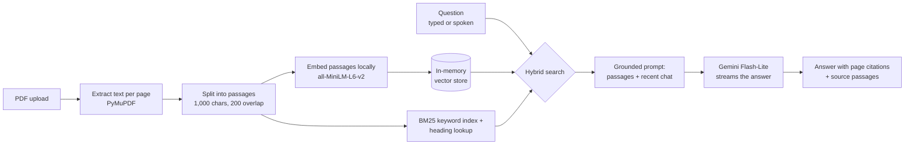

# DocBot: Document Q&A Chatbot

Upload a PDF and ask questions about it, by typing or speaking. Every answer cites the
pages it came from and shows the exact passages it used, so you can check it yourself.
If the document doesn't contain the answer, DocBot says so instead of making one up.

[](https://shruti-docbot.streamlit.app)

**Live demo:** https://shruti-docbot.streamlit.app. It works on phones too. If it has been idle,
click "Yes, get this app back up!" and give it about a minute to wake up.



| Upload screen | Dark mode | Mobile |
|---|---|---|
|  |  |  |

## Features

- **Answers grounded in your PDF.** DocBot answers only from the document, cites pages like
  "(page 41)", and lists the source passages under each answer.
- **Says "I couldn't find that"** when the document doesn't answer the question, instead of
  guessing from general knowledge.
- **Voice in, voice out.** Ask by microphone; spoken questions get spoken answers. Any answer can
  be replayed with **Listen**.
- **English and Hindi.** Questions in Hindi (or other non-Latin scripts) are answered in the same
  language.
- **Natural follow-ups.** "Explain that simply" or "tell me more" use the conversation so far.
- **Suggested questions** written from the uploaded document, so new users know where to start.
- **Works with any PDF.** Resumes, reports, handbooks, laws: nothing is tuned to one document.
- **Polished, accessible UI.** Separate light and dark colour themes, an animated robot mascot,
  a phone-friendly layout, and every animation is switched off for people who prefer reduced motion.

## How it works

DocBot is a retrieval-augmented generation (RAG) app:



1. **Indexing.** The PDF's text is split into overlapping passages, and each passage is turned into
   a vector by a small embedding model that runs on the server (no API cost).
2. **Retrieval.** Each question is matched three ways and the results are merged:
   meaning-based search (vectors), keyword search (BM25, for exact names and numbers), and a
   lookup for references like "Article 21" or "Section 4A".
   - Short documents (up to about 25 pages, like a resume) are sent to the model whole, so any
     question works, including "summarize this".
   - For summaries of long documents, passages are sampled from across the whole document.
3. **Answering.** Gemini gets the passages, the last few chat messages and strict rules:
   - use only the passages
   - cite pages
   - answer partially when that's all the passages support
   - otherwise reply "I couldn't find that in the document."

   The answer streams in word by word.
4. **Checking.** The pages the answer cites are matched to the passages it was given and shown as
   sources. A cited page that wasn't among them is flagged.
5. **Voice.** Spoken questions are transcribed by Gemini. Answers are read aloud by the browser's
   built-in speech engine.

**Speed:** the embedding model is loaded once, recently used PDFs stay in memory, and greetings
like "hi" or "thanks" get an instant reply without calling the model.

## Tech stack

| Part | Technology |
|---|---|
| App and UI | [Streamlit](https://streamlit.io), custom CSS (light/dark themes, animations) |
| LLM | Google Gemini 3.5 Flash-Lite via `langchain-google-genai` |
| Embeddings | `sentence-transformers/all-MiniLM-L6-v2` via `langchain-huggingface` (runs locally on CPU) |
| Retrieval | LangChain `InMemoryVectorStore` + a hand-written BM25 keyword index |
| PDF parsing | PyMuPDF |
| Text splitting | LangChain `RecursiveCharacterTextSplitter` |
| Hosting | Streamlit Community Cloud |

## Run it locally

You need Python 3.13 and a free Gemini API key from [Google AI Studio](https://aistudio.google.com/apikey).

```bash
git clone https://github.com/shruti041/docbot.git
cd docbot
python -m venv env
env\Scripts\activate          # Windows
# source env/bin/activate     # macOS / Linux
pip install -r requirements.txt
```

Copy `.env.example` to `.env` and put your key in it:

```
GOOGLE_API_KEY=your-key-here
```

Then start the app:

```bash
streamlit run app.py
```

The first start downloads the embedding model (about 90 MB).

## Configuration

Settings are read from environment variables, `.env`, or Streamlit secrets:

| Setting | Required | What it does |
|---|---|---|
| `GOOGLE_API_KEY` | Yes | Gemini API key |
| `APP_PASSWORD` | No | If set, visitors must enter this password first |
| `SAVE_INDEX_TO_DISK` | No | `1` saves each PDF's index to `vector_cache/` so it reopens instantly after a restart. Leave it off on a shared server. |

Limits that protect the server and the API quota are set at the top of `app.py`:

- 20 MB and 500 pages per PDF
- 30 questions per hour per visitor
- 300 questions per hour for the whole server

## Privacy

On the hosted demo, uploaded PDFs are processed in memory and never saved to disk. To answer a
question, the relevant passages (or the whole document, if it's short) and any voice recording
are sent to Google Gemini. Please don't upload confidential documents to the public demo.

## Limitations

- Scanned PDFs (images of text) aren't supported, because there's no OCR.
- One PDF at a time.
- On the free hosting plan, the app sleeps when nobody has used it for a while and takes about a
  minute to wake up.

## Project structure

```
app.py                  The whole app: indexing, retrieval, answering, voice and UI
requirements.txt        Exact package versions (CPU-only PyTorch on Linux)
.streamlit/config.toml  Theme colours, fonts and the upload size limit
.env.example            Settings template (copy to .env)
docs/screenshots/       Images used in this README
```
